<div align="center">

# Kairos

**Make Every Moment Count.**

An Apple-grade personal time and moments application built with Flutter. Kairos bridges precision instruments with a living timeline for the moments ahead of you, the present hour, and the memories behind you.

[](LICENSE)
[](https://flutter.dev)
[](https://dart.dev)
[](#package-identity)
[](#platform-support)
[](#privacy--architecture)

<br/>


</div>

---

## Why Kairos?

Traditional clock apps tell you what time it is, but say nothing about what the time is *for*. Countdown apps track events, but are often bloated, ad-supported, and visually dated.

Kairos unites **five dedicated time instruments** with a **living three-tense timeline**:

* **Next (Upcoming):** Look forward to what matters. Countdowns to flights, milestones, launches, and celebrations with continuous progress indicators.
* **Now (Present):** A real-time instrument dashboard featuring an oversized digital clock, active moments, and instant access to your daily tools.
* **Then (Memories):** Remember what has already happened. Milestones count up from the moment they pass, building a lasting personal record.
* **Warm Precision:** Crafted with the depth of a luxury timepiece and the quiet calm of an editorial magazine, using tabular grotesque numerals and warm squircle surfaces.

---

## Visual Showcase — Light & Dark Modes

Kairos treats **Light Mode** (warm ivory and paper) and **Dark Mode** (deep charcoal and obsidian) as first-class parallel palettes meeting WCAG AA contrast standards.

### 1. The Three Tenses (Now, Next, Then)

| Screen | Light Mode (Warm Paper) | Dark Mode (Obsidian Glass) |
|---|:---:|:---:|
| **Now Tab**<br><sub>Live 10:30.00 clock, active moments, and bento instrument tiles</sub> | 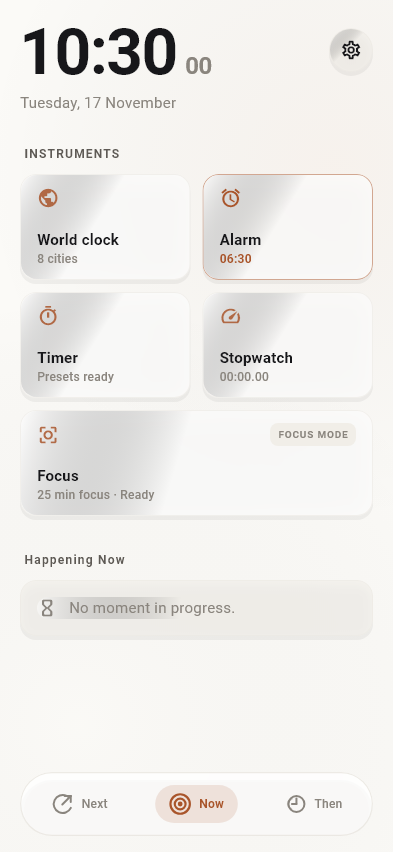 |  |
| **Next Tab**<br><sub>Upcoming countdowns, category badges, and progress arcs</sub> | 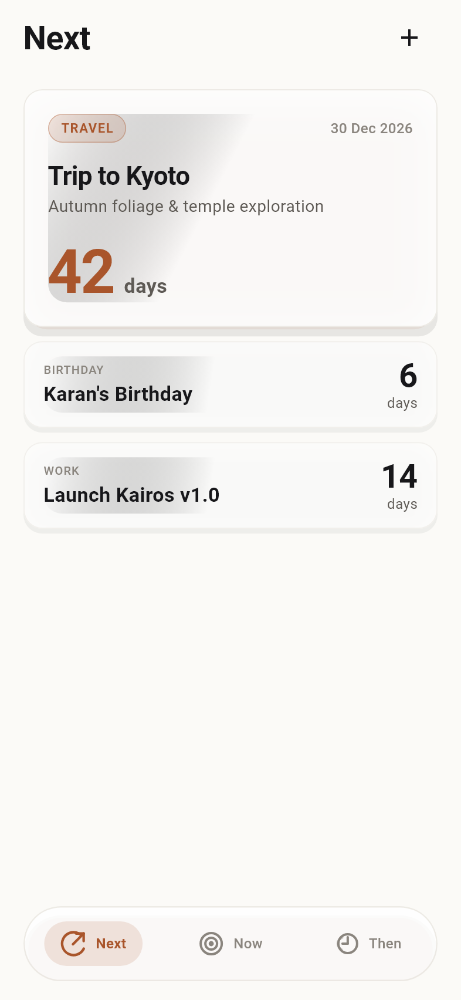 |  |
| **Then Tab**<br><sub>Historical milestones and elapsed count-up timeline</sub> | 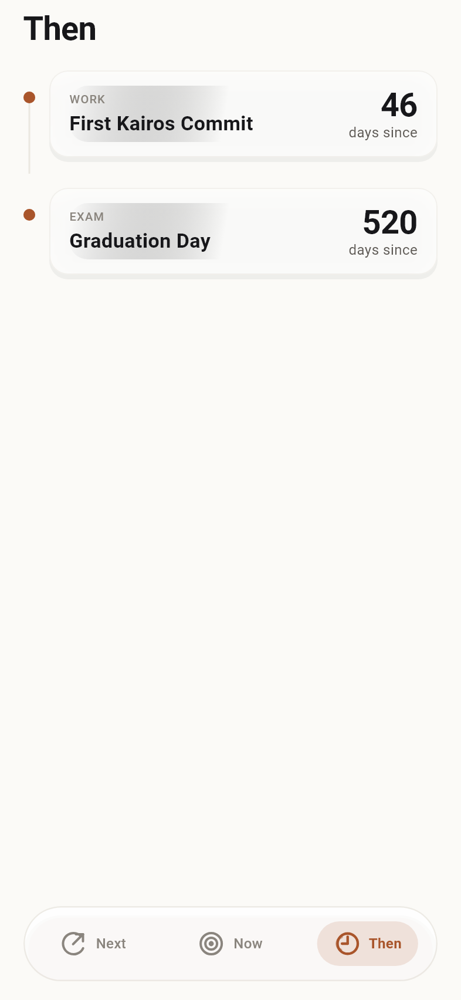 | 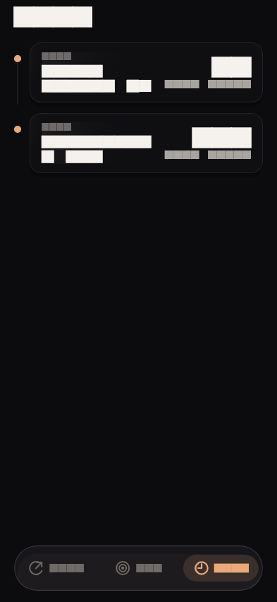 |
| **Next Tab (Empty)**<br><sub>Calm editorial invitation and clear creation CTA</sub> | 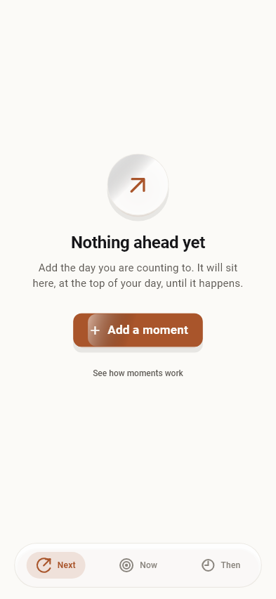 | 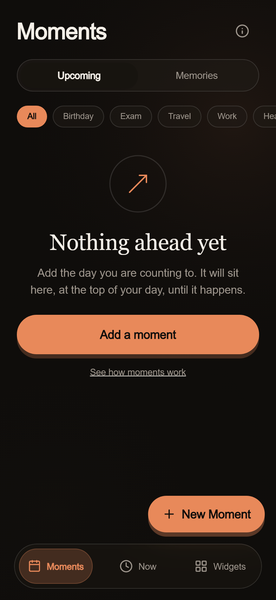 |

---

### 2. The Five Precision Instruments

| Instrument | Light Mode | Dark Mode |
|---|:---:|:---:|
| **World Clock**<br><sub>3D solar terminator globe & time-travel slider</sub> | 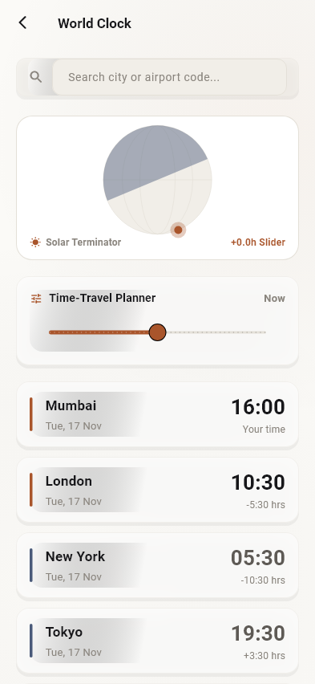 |  |
| **Alarm Editor**<br><sub>06:30 hero card, 90-min REM sleep cycles, & puzzles</sub> | 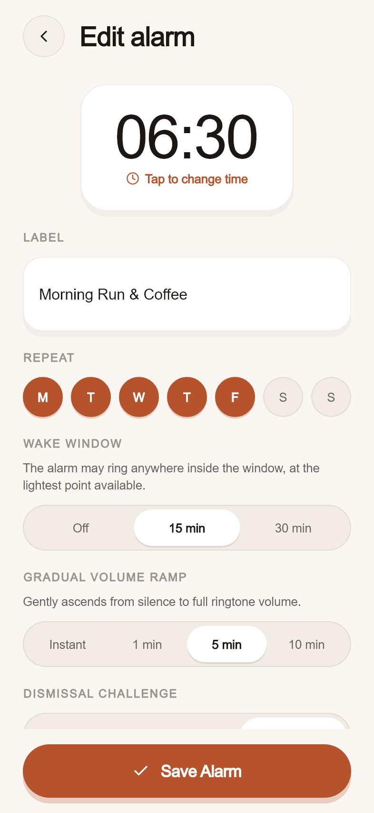 | 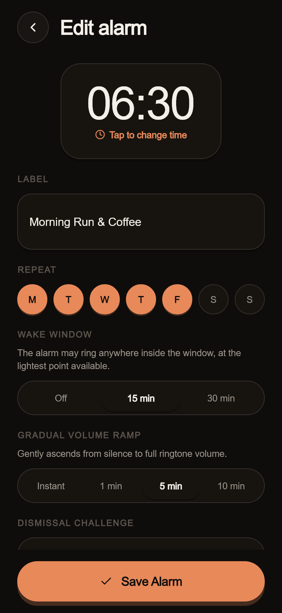 |
| **Timer**<br><sub>290pt progress ring and rapid interval presets</sub> | 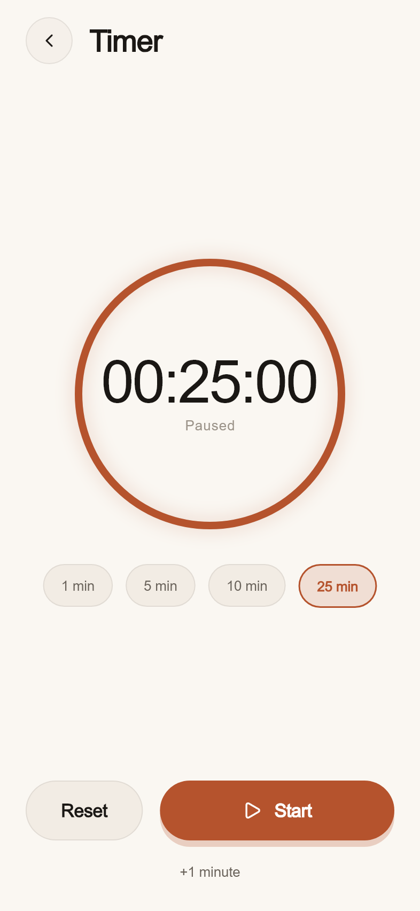 | 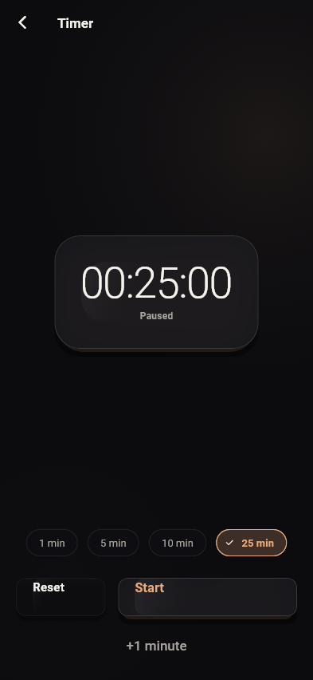 |
| **Stopwatch**<br><sub>Analog sweeping dial and precision lap highlights</sub> | 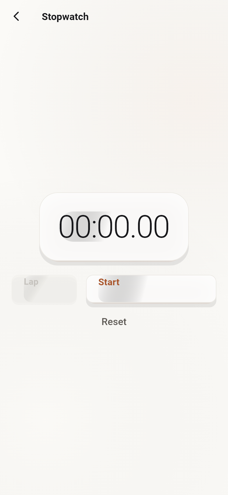 |  |
| **Focus Sessions**<br><sub>Ambient soundscapes & weekly activity heatmap</sub> | 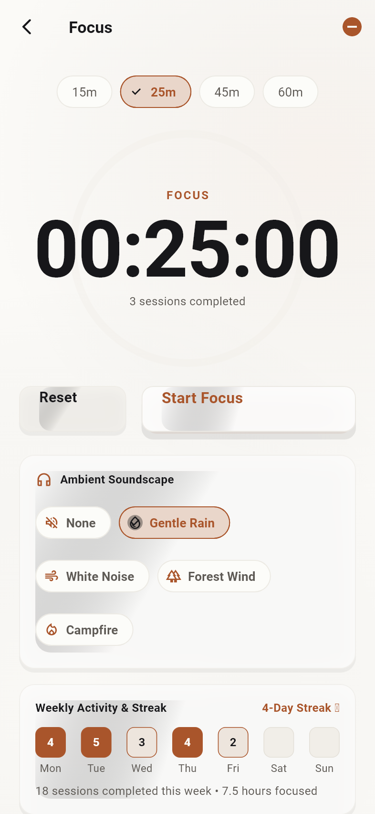 | 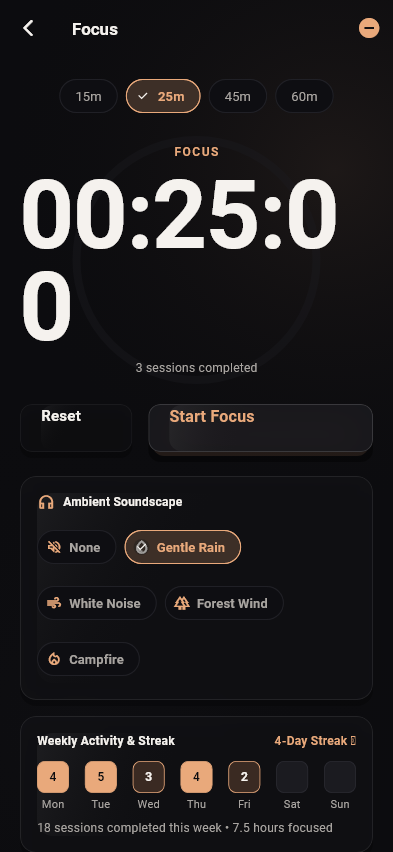 |

---

### 3. Moments & Personalization

| Screen | Light Mode | Dark Mode |
|---|:---:|:---:|
| **Moment Detail**<br><sub>Giant tabular numerals & editorial event header</sub> | 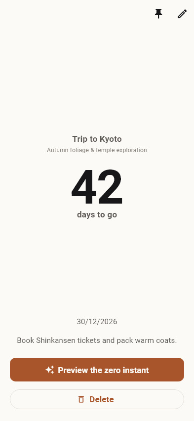 | 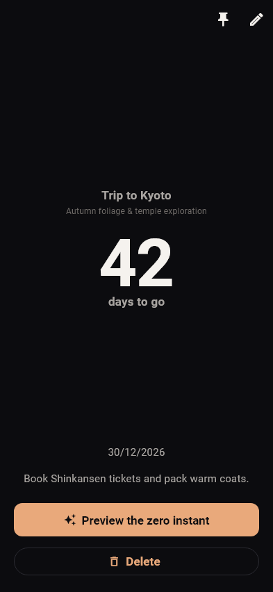 |
| **The Zero Moment**<br><sub>Radial light bloom, confetti particles, & haptics</sub> | 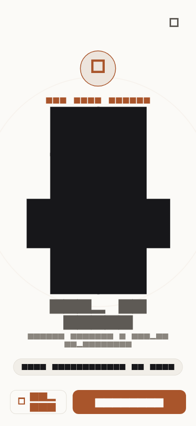 | 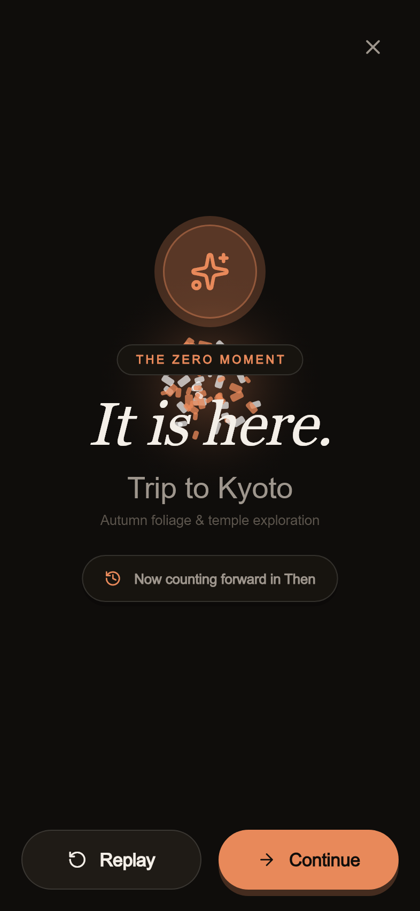 |
| **Settings Center**<br><sub>5 accent swatches, theme mode, & privacy controls</sub> | 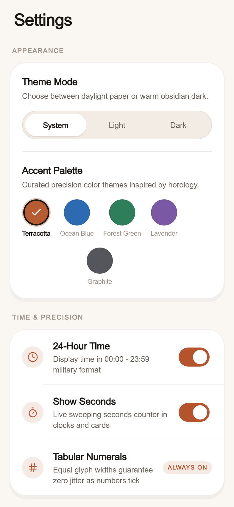 | 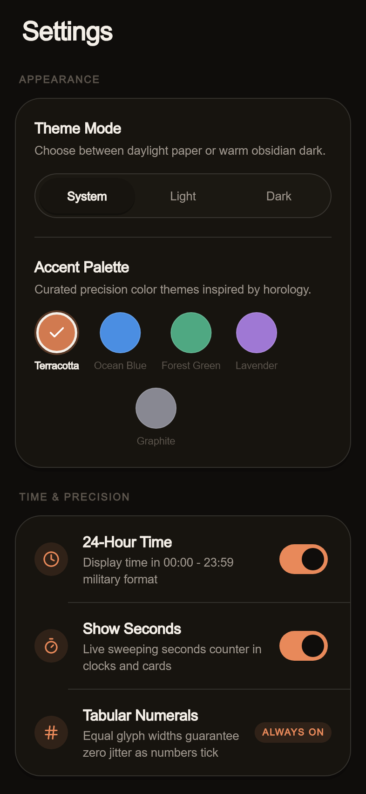 |

*Browse all 32 unmasked screen captures in the [`screenshots/`](screenshots/) directory or view the [Interactive HTML Gallery](screenshots/index.html).*

---

## Package Identity

| Platform | Identifier |
|---|---|
| **Android Package / Application ID** | `com.samyukt.kairos` |
| **iOS Bundle Identifier** | `com.samyukt.kairos` |
| **Minimum Android SDK** | API 24 (Android 7.0) |
| **Minimum iOS Version** | iOS 17.0 |

---

## Release & APK Distribution

Kairos includes a complete release system for automated GitHub Releases and local compilation.

### Automated GitHub Release System
Releases are built automatically via GitHub Actions ([`.github/workflows/release.yml`](.github/workflows/release.yml)):
```bash
# Push a semantic version tag to trigger the release workflow
git tag -a v1.0.0 -m "Release v1.0.0"
git push origin v1.0.0
```
This automatically compiles:
* `kairos-universal-release.apk` (All-in-one APK for direct installation / sideloading)
* `kairos-arm64-v8a-release.apk` (Optimized for modern 64-bit Android devices)
* `kairos-armeabi-v7a-release.apk` (Optimized for 32-bit Android devices)
* `kairos-x86_64-release.apk` (Tablets and emulators)
* `kairos-release.aab` (Google Play App Bundle)
* `SHA256SUMS.txt` (Cryptographic verification checksums)

### Building Release APK Locally
```bash
# Build universal release APK
flutter build apk --release

# Build architecture-split APKs (smallest size)
flutter build apk --release --split-per-abi

# Build Play Store App Bundle (AAB)
flutter build appbundle --release
```
*Outputs are saved to `build/app/outputs/flutter-apk/app-release.apk`.*

*For detailed instructions on keystore signing and release management, see [RELEASE.md](RELEASE.md).*

---

## Technology Stack

* **Framework:** [Flutter](https://flutter.dev) (v3.44.8+) & [Dart](https://dart.dev)
* **State Management:** [Riverpod 3](https://riverpod.dev) (`Notifier` and `AsyncNotifier` architecture)
* **Typography:** [Google Fonts](https://pub.dev/packages/google_fonts) (`Bricolage Grotesque`, `Inter`, `Fraunces`)
* **Iconography:** [Lucide Icons](https://pub.dev/packages/lucide_icons_flutter) (consistent 1.75pt optical stroke)
* **Local Storage:** `shared_preferences` key-value cache (with planned relational Drift SQLite migration)
* **Time Architecture:** Injectable `Clock` provider with all internal arithmetic executed strictly in UTC

---

## Getting Started

### Prerequisites
* [Flutter SDK](https://docs.flutter.dev/get-started/install) (`>= 3.44.8` on stable channel)
* Android Studio / Xcode / VS Code with Dart & Flutter extensions
* Android SDK (API 24+) or iOS Simulator (iOS 17+)

### Installation

1. **Clone the repository:**
   ```bash
   git clone https://github.com/kachakaran6/kairos.git
   cd kairos
   ```

2. **Install Flutter packages:**
   ```bash
   flutter pub get
   ```

3. **Run Quality Gates:**
   ```bash
   # Formatting check
   dart format --set-exit-if-changed .

   # Static code analysis
   flutter analyze --fatal-infos

   # Unit and widget test suite
   flutter test

   # Token & string validation
   dart run tool/check_tokens.dart
   dart run tool/check_strings.dart
   ```

4. **Launch the application:**
   ```bash
   # Run on connected device or emulator
   flutter run
   ```

---

## Project Structure

```
kairos/
├── android/               # Native Android host & Glance widget targets (com.samyukt.kairos)
├── ios/                   # Native iOS host & WidgetKit extension targets (com.samyukt.kairos)
├── lib/
│   ├── app/               # App bootstrap, router, shell, and theme data
│   │   ├── shell/         # Three-tab floating pill navigation & shell scaffold
│   │   └── theme/         # ThemeData wiring & color mapping
│   ├── core/              # Foundational cross-cutting layers
│   │   ├── design/        # Design tokens (colour, typography, spacing, radius, motion)
│   │   ├── platform/      # Native widget bridge & SharedPreferences contract
│   │   ├── theme/         # KairosTheme ThemeExtension implementation
│   │   ├── time/          # Injectable clock, countdown engine, regional calendars
│   │   └── widgets/       # Shared UI components (SurfaceCard, PillButton, Scaffold)
│   └── features/          # Feature-first domain modules
│       ├── alarm/         # Wake alarms, sleep cycles, dismissal challenges
│       ├── focus/         # Focus sessions, ambient audio, activity heat map
│       ├── moments/       # Countdowns, count-ups, editor, zero moment celebration
│       ├── settings/      # Personalization center, theme modes, accent swatches
│       ├── stopwatch/     # Precision analog dial & lap tracking
│       ├── timer/         # Multi-interval timer & progress ring
│       └── world_clock/   # 3D day/night terminator globe & city times
├── screenshots/           # Canonical screen captures & interactive gallery
├── test/                  # Unit, widget, and automated screen verification tests
└── tool/                  # Continuous quality gate scripts (tokens & strings check)
```

---

## Contributing

We welcome contributions! Please read our [Contributing Guidelines](CONTRIBUTING.md) and [Code of Conduct](CODE_OF_CONDUCT.md) before submitting pull requests.

Check out issues tagged [`good first issue`](https://github.com/kachakaran6/kairos/issues?q=is%3Aissue+is%3Aopen+label%3A%22good+first+issue%22) for beginner-friendly tasks.

---

## Security

For security vulnerability reporting, please see [SECURITY.md](SECURITY.md). Please do not disclose vulnerabilities via public issues.

---

## License

Kairos is open-source software licensed under the [MIT License](LICENSE).

---

<div align="center">
Built with care. Designed around time. Made for everyone.
</div>
