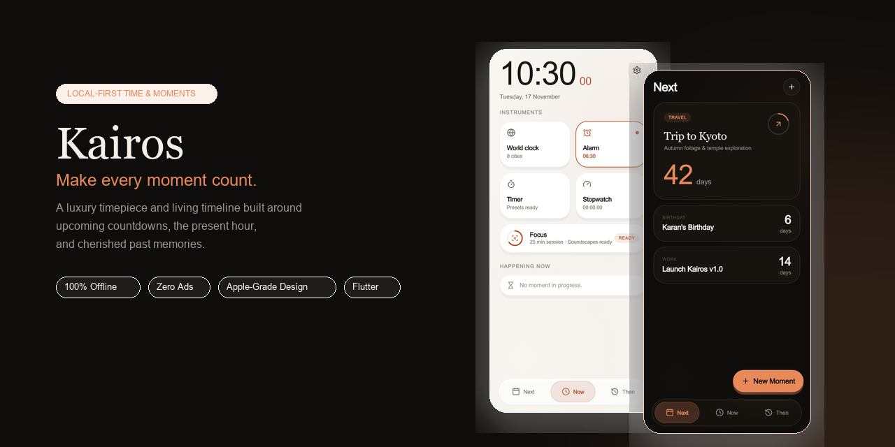
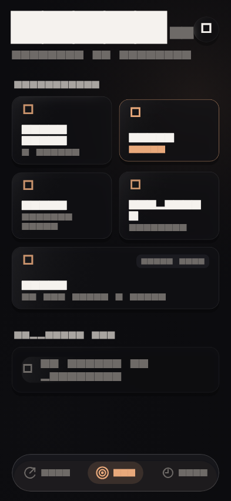
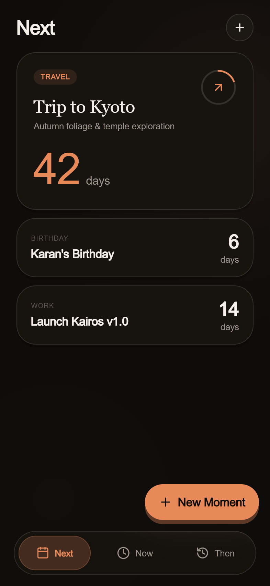
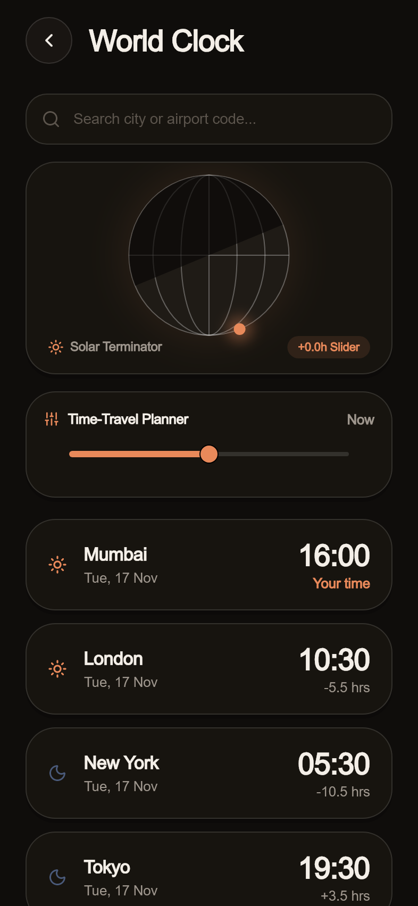
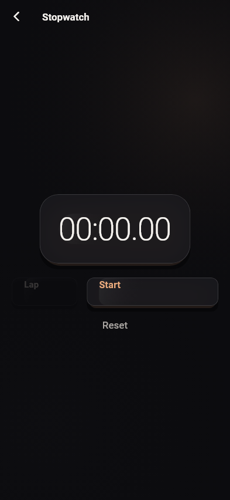

<div align="center">

# Kairos

**Make Every Moment Count.**

An Apple-grade personal time and moments application built with Flutter. Kairos bridges precision instruments with a living timeline for the moments ahead of you, the present hour, and the memories behind you.

[](LICENSE)
[](https://flutter.dev)
[](https://dart.dev)
[](#platform-support)
[](#privacy--architecture)

<br/>



</div>

---

## Why Kairos?

Traditional clock apps tell you what time it is, but say nothing about what the time is *for*. Countdown apps track events, but are often bloated, ad-supported, and visually dated.

Kairos unites **five dedicated time instruments** with a **living three-tense timeline**:

* **Next (Upcoming):** Look forward to what matters. Countdowns to flights, milestones, launches, and celebrations with continuous progress indicators.
* **Now (Present):** A real-time instrument dashboard featuring an oversized digital clock, active moments, and instant access to your daily tools.
* **Then (Memories):** Remember what has already happened. Milestones count up from the moment they pass, building a lasting personal record.
* **Instrument-Grade Quality:** Every instrument is crafted with the depth of a standalone app, following a "Warm Precision" design language inspired by luxury horology and calm editorial layouts.

---

## Visual Showcase

| Now (Dashboard) | Next (Countdowns) | Then (Timeline) | World Clock |
|:---:|:---:|:---:|:---:|
|  |  |  |  |

| Alarm & Sleep Cycles | Timer (Progress Ring) | Stopwatch (Analog Dial) | Focus & Soundscapes |
|:---:|:---:|:---:|:---:|
|  |  |  |  |

*Explore all 32 light and dark mode screen captures in the [`screenshots/`](screenshots/) directory or launch the [Interactive Gallery](screenshots/index.html).*

---

## Features

### 1. Three-Tense Moments Engine
* **Countdowns & Count-Ups:** Seamless transition from countdown (*Next*) to zero-moment celebration (*Now*) to count-up memory (*Then*).
* **The Zero Moment:** Full-screen celebratory animation featuring radial light bloom, golden particle burst, editorial typography, and haptic feedback.
* **Categories & Priorities:** Tag moments as Travel, Birthday, Work, Exam, Health, Festival, Memorial, or Custom, with priority pinning.
* **Regional Calendars:** Built-in Vikram Samvat, Islamic Hijri, and lunar phase calculations.

### 2. Five Precision Instruments
* **World Clock:** Interactive 3D orthographic globe with a day/night solar terminator curve, sun position indicator, and time-travel planner slider.
* **Alarms:** 90-minute REM sleep cycle calculator, gradual volume ramping, wake windows, and wake-up challenges (Shake, Math, Phrase).
* **Timer:** 290pt progress track, rapid interval presets (1m, 5m, 15m, 25m), and pause/resume controls.
* **Stopwatch:** Dual analog dial with sweeping seconds hand, tabular centisecond precision, and lap highlight cards.
* **Focus Sessions:** 25-minute Pomodoro timer, 5 ambient soundscapes (Rain, White Noise, Forest, Cafe), auto-DND integration, and a 7-day activity heatmap.

### 3. "Warm Precision" Design System
* **Typography:** Tabular display numerals ensuring clock digits never reflow or jitter mid-tick, paired with editorial serif headlines and geometric body copy.
* **Continuous Squircles:** Smooth continuous curvature across cards (28pt), form inputs (20pt), and pill buttons.
* **5 Accent Palettes:** Warm Terracotta, Ocean Blue, Forest Green, Lavender, and Graphite, fully adaptable across first-class Light and Dark themes meeting WCAG AA contrast.

### 4. Privacy & Architecture
* **100% Offline & Local-First:** Every feature works without internet connectivity.
* **Zero Accounts & Zero Tracking:** No login required. No third-party tracking or advertising SDKs.
* **No Marketing Notifications:** Only functional alarms and user-configured moment alerts.

---

## Technology Stack

* **Framework:** [Flutter](https://flutter.dev) (v3.44.8+) & [Dart](https://dart.dev)
* **State Management:** [Riverpod 3](https://riverpod.dev) (`Notifier` and `AsyncNotifier` architecture)
* **Typography:** [Google Fonts](https://pub.dev/packages/google_fonts) (`Bricolage Grotesque`, `Inter`, `Fraunces`)
* **Iconography:** [Lucide Icons](https://pub.dev/packages/lucide_icons_flutter) (consistent 1.75pt optical stroke)
* **Local Storage:** `shared_preferences` key-value cache (with planned relational Drift SQLite migration)
* **Time Architecture:** Injectable `Clock` provider with all internal arithmetic executed strictly in UTC

---

## Getting Started

### Prerequisites
* [Flutter SDK](https://docs.flutter.dev/get-started/install) (`>= 3.44.8` on stable channel)
* Android Studio / Xcode / VS Code with Dart & Flutter extensions
* Android SDK (API 26+) or iOS Simulator (iOS 17+)

### Installation

1. **Clone the repository:**
   ```bash
   git clone https://github.com/kachakaran6/kairos.git
   cd kairos
   ```

2. **Install Flutter packages:**
   ```bash
   flutter pub get
   ```

3. **Run Quality Gates:**
   ```bash
   # Formatting check
   dart format --set-exit-if-changed .

   # Static analysis
   flutter analyze --fatal-infos

   # Unit and widget test suite
   flutter test

   # Token & string validation
   dart run tool/check_tokens.dart
   dart run tool/check_strings.dart
   ```

4. **Launch the application:**
   ```bash
   # Run on connected device or emulator
   flutter run
   ```

---

## Project Structure

```
kairos/
├── android/               # Native Android host & Glance widget targets
├── ios/                   # Native iOS host & WidgetKit extension targets
├── lib/
│   ├── app/               # App bootstrap, router, shell, and theme data
│   │   ├── shell/         # Three-tab floating pill navigation & shell scaffold
│   │   └── theme/         # ThemeData wiring & color mapping
│   ├── core/              # Foundational cross-cutting layers
│   │   ├── design/        # Design tokens (colour, typography, spacing, radius, motion)
│   │   ├── platform/      # Native widget bridge & SharedPreferences contract
│   │   ├── theme/         # KairosTheme ThemeExtension implementation
│   │   ├── time/          # Injectable clock, countdown engine, regional calendars
│   │   └── widgets/       # Shared UI components (SurfaceCard, PillButton, Scaffold)
│   └── features/          # Feature-first domain modules
│       ├── alarm/         # Wake alarms, sleep cycles, dismissal challenges
│       ├── focus/         # Focus sessions, ambient audio, activity heat map
│       ├── moments/       # Countdowns, count-ups, editor, zero moment celebration
│       ├── settings/      # Personalization center, theme modes, accent swatches
│       ├── stopwatch/     # Precision analog dial & lap tracking
│       ├── timer/         # Multi-interval timer & progress ring
│       └── world_clock/   # 3D day/night terminator globe & city times
├── screenshots/           # Canonical screen captures & interactive gallery
├── test/                  # Unit, widget, and automated screen verification tests
└── tool/                  # Continuous quality gate scripts (tokens & strings check)
```

---

## Roadmap

### Completed (v1.0)
- [x] Three-tense timeline engine (Next, Now, Then).
- [x] Complete Moments CRUD with pinned priorities and categories.
- [x] The Zero Moment celebration sequence (radial bloom, confetti, haptics).
- [x] World Clock with 3D solar day/night terminator and time-travel slider.
- [x] Alarms with 90-minute sleep cycle calculator and puzzle dismissals.
- [x] Timer with 290pt progress ring and rapid interval presets.
- [x] Stopwatch with analog sweeping dial and lap timing.
- [x] Focus timer with ambient soundscapes and weekly activity heatmap.
- [x] Settings center with 5 accent palettes and dark/light theme switching.
- [x] Regional calendar calculations (Vikram Samvat, Hijri, lunar phases).
- [x] Shared AppGroup / SharedPreferences native widget data bridge.

### In Progress
- [ ] Relational Drift (SQLite) persistence schema with database migrations.
- [ ] Concurrent multi-stage timer recipes.

### Planned
- [ ] Native iOS Lock Screen & Home Screen widgets (SwiftUI / WidgetKit).
- [ ] Native Android widgets (Jetpack Glance).
- [ ] Apple Watch & Wear OS companion applications.
- [ ] Opt-in encrypted peer-to-peer cloud sync.

---

## Contributing

We welcome contributions! Please read our [Contributing Guidelines](CONTRIBUTING.md) and [Code of Conduct](CODE_OF_CONDUCT.md) before submitting pull requests.

Check out issues tagged [`good first issue`](https://github.com/kachakaran6/kairos/issues?q=is%3Aissue+is%3Aopen+label%3A%22good+first+issue%22) for beginner-friendly tasks.

---

## Security

For security vulnerability reporting, please see [SECURITY.md](SECURITY.md). Please do not disclose vulnerabilities via public issues.

---

## License

Kairos is open-source software licensed under the [MIT License](LICENSE).

---

<div align="center">
Built with care. Designed around time. Made for everyone.
</div>
